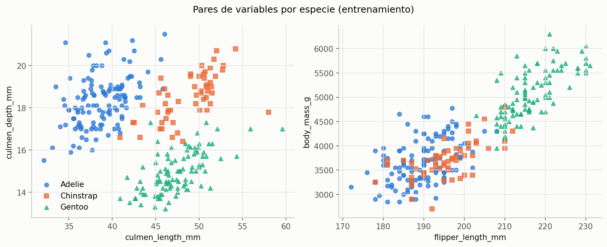
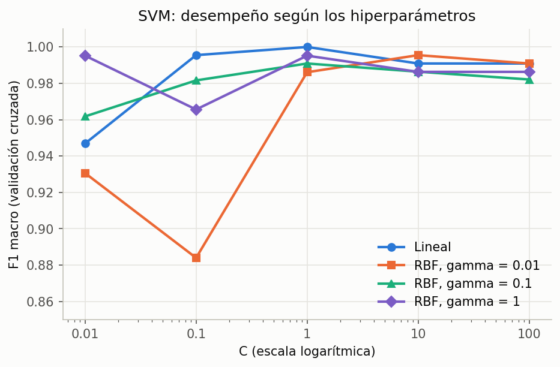
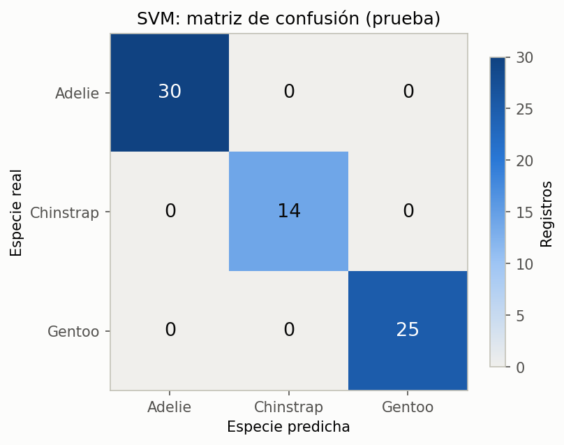

# Resultados de CRISP-DM

Clasificación de la especie de pingüino (`species`) con la base Palmer Penguins (`penguins_size.csv`), aplicando CRISP-DM en sus seis fases.

> **Caso de demostración:** la estación de investigación y su necesidad son hipotéticas. Su propósito es mostrar cómo CRISP-DM parte de un objetivo de negocio y termina en un despliegue.

## Comprensión del negocio

- **Situación:** una estación de investigación registra las medidas, la isla y el sexo de cada pingüino que captura, y la especie se anota a mano en campo. Un error de captura en la especie llega a la base sin que nadie lo note.
- **Objetivo del negocio:** revisar automáticamente la especie anotada y marcar para revisión los registros en los que el modelo no coincide o no tiene suficiente confianza.
- **Objetivo de minería de datos:** clasificar la especie a partir de las cuatro medidas, la isla y el sexo, con una máquina de vectores de soporte (SVM).

### Criterios de éxito

| Criterio | Meta |
| --- | --- |
| F1 macro en prueba | Al menos 0.95 |
| Sensibilidad de cada especie | Al menos 0.90 |
| Revisión manual | Registros con probabilidad máxima menor que 0.80 |

## Modelo

| Concepto | Valor |
| --- | --- |
| Algoritmo | SVM con kernel lineal, calibrada con `CalibratedClassifierCV` |
| Hiperparámetros | `C` = 1, elegido por validación cruzada |
| Vectores de soporte | 20 (Adelie 9, Chinstrap 7, Gentoo 4) |
| Predictores | 4 medidas numéricas estandarizadas, `island` y `sex` en one-hot |
| Tratamiento de `sex` | Valores distintos de `MALE` y `FEMALE` agrupados como `UNKNOWN` |
| Registros eliminados | 2 sin ninguna medida (`row_id` 3 y 339) |
| Modelo de referencia | Predicción constante de la especie más frecuente (Adelie) |
| Semilla | `SEED = 1` |

La calibración convierte las salidas de la SVM en probabilidades, que el criterio de revisión manual necesita.

## Datos

Partición 80/20 estratificada por `species`, hecha antes de explorar y limpiar.

| Especie | Total | Entrenamiento | Prueba |
| --- | --- | --- | --- |
| Adelie | 152 | 122 | 30 |
| Gentoo | 124 | 99 | 25 |
| Chinstrap | 68 | 54 | 14 |
| **Total** | **344** | **275** | **69** |

## Validación cruzada

Validación cruzada estratificada de 5 pliegues sobre el grupo de entrenamiento (273 registros tras la limpieza). La búsqueda probó 20 combinaciones: kernel lineal con 5 valores de `C`, y kernel RBF con 5 valores de `C` y 3 de `gamma`.

| Modelo | Kernel | `C` | `gamma` | F1 macro | Exactitud |
| --- | --- | --- | --- | --- | --- |
| Referencia | — | — | — | 0.205 ± 0.003 | 0.443 ± 0.010 |
| **SVM elegida** | **Lineal** | **1** | **—** | **1.000 ± 0.000** | **1.000 ± 0.000** |
| SVM | Lineal | 0.1 | — | 0.996 ± 0.009 | 0.996 ± 0.007 |
| SVM | RBF | 10 | 0.01 | 0.996 ± 0.009 | 0.996 ± 0.007 |
| Peor combinación | RBF | 0.1 | 0.01 | 0.884 | — |

## Evaluación

### Métricas globales

| Modelo | Exactitud | Exactitud balanceada | F1 macro | Errores |
| --- | --- | --- | --- | --- |
| Referencia | 0.435 | 0.333 | 0.202 | 39 de 69 |
| **SVM** | **1.000** | **1.000** | **1.000** | **0 de 69** |

### Métricas por especie

| Especie | Precisión | Sensibilidad | F1 | Registros |
| --- | --- | --- | --- | --- |
| Adelie | 1.000 | 1.000 | 1.000 | 30 |
| Chinstrap | 1.000 | 1.000 | 1.000 | 14 |
| Gentoo | 1.000 | 1.000 | 1.000 | 25 |

### Verificación de los criterios de éxito

| Criterio | Meta | Resultado | ¿Cumple? |
| --- | --- | --- | --- |
| F1 macro en prueba | Al menos 0.95 | 1.000 | Sí |
| Sensibilidad mínima por especie | Al menos 0.90 | 1.000 | Sí |
| Revisión manual | Probabilidad menor que 0.80 | 0 de 69 registros marcados | Sí |

La probabilidad máxima más baja en prueba fue 0.919, y 68 de las 69 predicciones superaron 0.95.

## Despliegue

La función `review_records` del notebook `06_deployment.ipynb` aplica la limpieza de la fase de preparación y compara la especie predicha con la anotada en campo. Rechaza registros de islas fuera de la base de datos y registros sin ninguna medida.

| Registro de ejemplo | Especie anotada | Especie predicha | Probabilidad | ¿Revisar? |
| --- | --- | --- | --- | --- |
| ejemplo_1 | Gentoo | Gentoo | 0.998 | No |
| ejemplo_2 | Adelie | Chinstrap | 0.985 | Sí |
| ejemplo_3 | Adelie | Adelie | 0.994 | No |

El segundo registro de ejemplo simula un error de captura: sus medidas corresponden a un Chinstrap, pero se anotó como Adelie.

## Conclusiones

- La SVM cumple los dos criterios de desempeño definidos en la comprensión del negocio, con margen: F1 macro y sensibilidad de 1.000 en prueba.
- El kernel lineal fue suficiente. Las especies se separan con fronteras lineales cuando las medidas están estandarizadas, y el kernel RBF no mejoró el resultado.
- Ningún registro de prueba quedó marcado para revisión. Con 69 registros, eso no garantiza el mismo comportamiento con datos nuevos; los registros marcados en uso real permitirán ajustar el umbral de 0.80.
- El modelo solo aplica a pingüinos de las tres islas del archipiélago Palmer, porque usa la isla como predictor.
- Para el uso continuo, conviene revisar cada temporada cuántos registros se marcan y cuántos de ellos eran errores reales, y reentrenar el modelo cuando se acumulen registros nuevos verificados.
