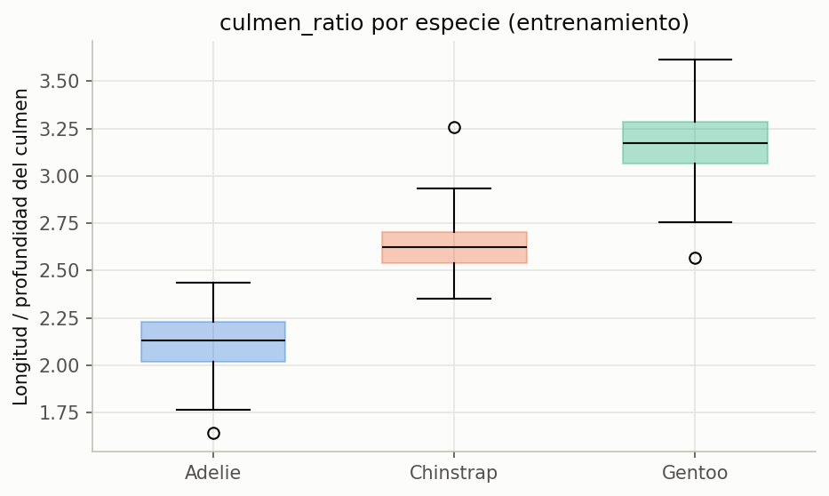
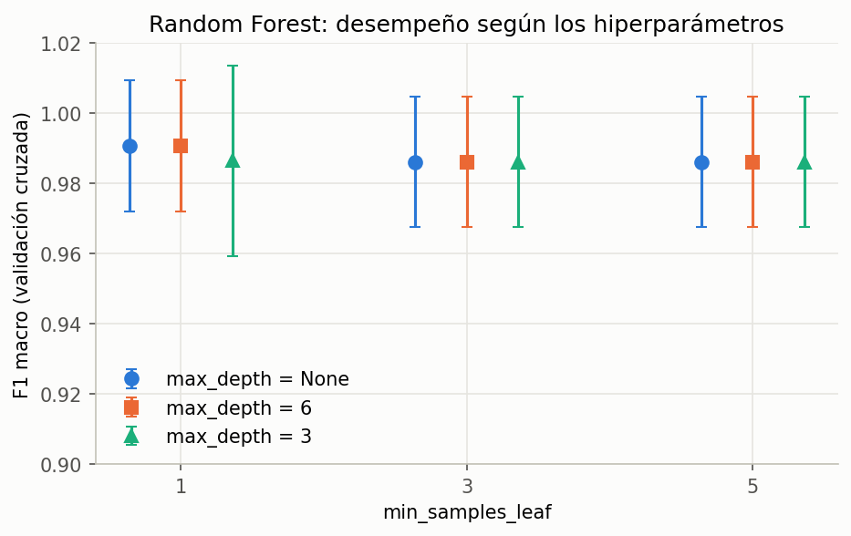
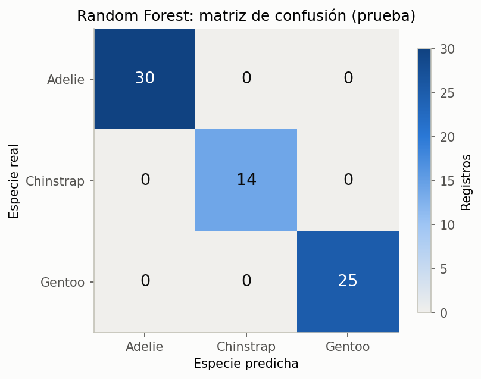
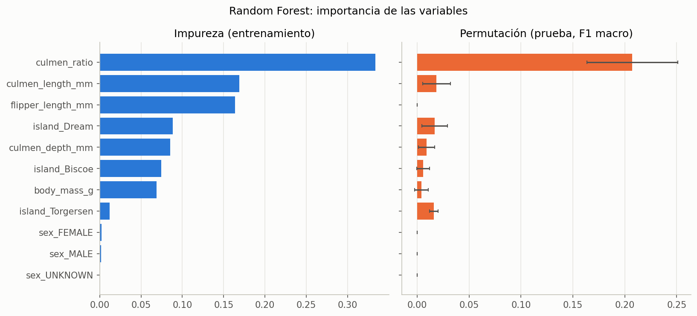

# Resultados de KDD

Clasificación de la especie de pingüino (`species`) con la base Palmer Penguins (`penguins_size.csv`), aplicando KDD en cinco fases: selección, preprocesamiento, transformación, minería de datos, e interpretación y evaluación.

## Modelo

| Concepto | Valor |
| --- | --- |
| Algoritmo | Random Forest |
| Hiperparámetros | 200 árboles, sin límite de profundidad, `min_samples_leaf` = 1, `max_features` = `sqrt` |
| Predictores | 4 medidas numéricas, la variable derivada `culmen_ratio`, y `island` y `sex` en one-hot |
| Variable derivada | `culmen_ratio`: longitud entre profundidad del culmen |
| Tratamiento de `sex` | Valores distintos de `MALE` y `FEMALE` agrupados como `UNKNOWN` |
| Registros eliminados | 2 sin ninguna medida (`row_id` 3 y 339) |
| Modelo de referencia | Predicción constante de la especie más frecuente (Adelie) |
| Semilla | `SEED = 1` |

## Datos

Partición 80/20 estratificada por `species`, hecha antes de cualquier limpieza.

| Especie | Total | Entrenamiento | Prueba |
| --- | --- | --- | --- |
| Adelie | 152 | 122 | 30 |
| Gentoo | 124 | 99 | 25 |
| Chinstrap | 68 | 54 | 14 |
| **Total** | **344** | **275** | **69** |

## Validación cruzada

Validación cruzada estratificada de 5 pliegues sobre el grupo de entrenamiento (273 registros tras la limpieza). La búsqueda probó 36 combinaciones de `n_estimators`, `max_depth`, `min_samples_leaf` y `max_features`.

| Modelo | F1 macro | Exactitud |
| --- | --- | --- |
| Referencia | 0.205 ± 0.003 | 0.443 ± 0.010 |
| **Random Forest elegido** | **0.991 ± 0.019** | **0.993 ± 0.015** |
| Peor combinación de Random Forest | 0.982 | — |

Todas las combinaciones obtuvieron un F1 macro entre 0.982 y 0.991. Cuatro empataron en el primer lugar; `GridSearchCV` conservó la primera de la lista. La exactitud fuera de bolsa (OOB) del modelo final es 0.989.

## Grupo de prueba

### Métricas globales

| Modelo | Exactitud | Exactitud balanceada | F1 macro | Errores |
| --- | --- | --- | --- | --- |
| Referencia | 0.435 | 0.333 | 0.202 | 39 de 69 |
| **Random Forest** | **1.000** | **1.000** | **1.000** | **0 de 69** |

### Métricas por especie

| Especie | Precisión | Sensibilidad | F1 | Registros |
| --- | --- | --- | --- | --- |
| Adelie | 1.000 | 1.000 | 1.000 | 30 |
| Chinstrap | 1.000 | 1.000 | 1.000 | 14 |
| Gentoo | 1.000 | 1.000 | 1.000 | 25 |

### Confianza de las predicciones

| Probabilidad máxima | Predicciones |
| --- | --- |
| Menor que 0.60 | 1 |
| 0.60 a 0.80 | 1 |
| 0.80 a 0.95 | 7 |
| 0.95 o más | 60 |

## Interpretación

| Variable | Importancia por impureza | Importancia por permutación |
| --- | --- | --- |
| `culmen_ratio` | 0.333 | 0.207 |
| `culmen_length_mm` | 0.169 | 0.019 |
| `flipper_length_mm` | 0.164 | 0.000 |
| `island_Dream` | 0.089 | 0.017 |
| `culmen_depth_mm` | 0.086 | 0.009 |
| `island_Biscoe` | 0.075 | 0.006 |
| `body_mass_g` | 0.069 | 0.004 |
| `island_Torgersen` | 0.012 | 0.016 |
| `sex` (tres columnas) | 0.004 | 0.000 |

La importancia por impureza se calcula durante el entrenamiento. La de permutación mide cuánto baja el F1 macro en prueba al desordenar cada variable, con 30 repeticiones.

## Conclusiones

- El Random Forest clasificó correctamente los 69 pingüinos de prueba, frente a un F1 macro de 0.202 del modelo de referencia.
- El resultado en prueba (1.000) es cercano al de validación cruzada (0.991), así que no hay señales de sobreajuste. Un resultado perfecto en 69 registros no garantiza el mismo desempeño con datos nuevos: dos predicciones correctas tuvieron una probabilidad máxima menor que 0.80, una de ellas de apenas 0.375.
- `culmen_ratio`, la variable creada en la fase de transformación, es la más importante con las dos medidas. Separa a las tres especies por la forma del pico: Adelie tiene el pico más corto y profundo, Gentoo el más largo y delgado, y Chinstrap queda en medio.
- `flipper_length_mm` tiene una importancia alta por impureza, pero nula por permutación: la información que aporta ya está en otras variables, por lo que el modelo no pierde nada al desordenarla.
- El sexo casi no interviene en las decisiones del modelo.
- El modelo usa la isla como predictor, por lo que solo aplica a pingüinos de las tres islas del archipiélago Palmer.
