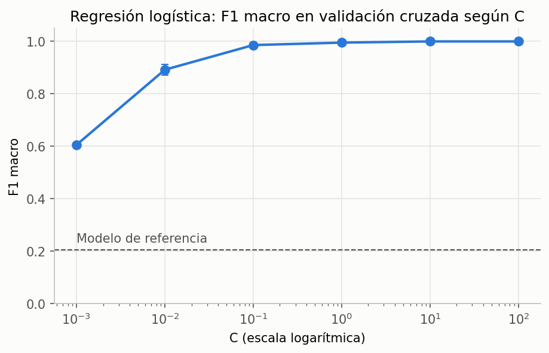
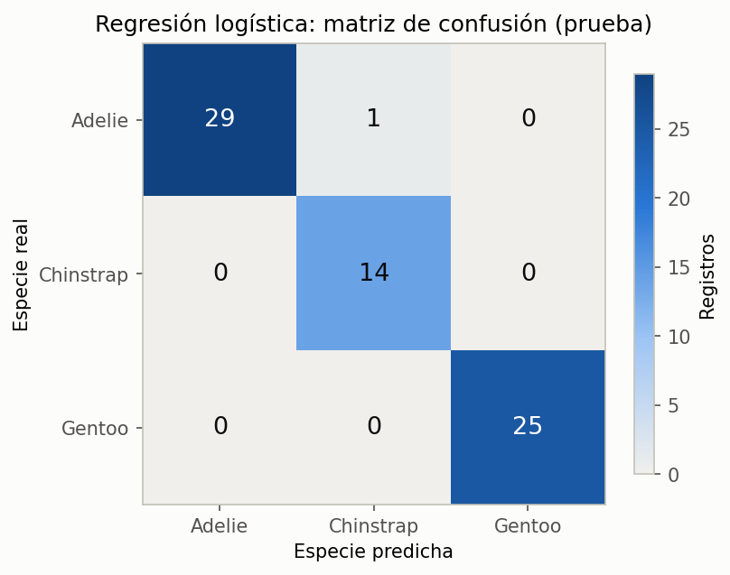

# Resultados de SEMMA

Clasificación de la especie de pingüino (`species`) con la base Palmer Penguins (`penguins_size.csv`), aplicando SEMMA.

## Modelo

| Concepto | Valor |
| --- | --- |
| Algoritmo | Regresión logística multinomial con regularización L2 |
| Parámetro de regularización | `C` = 10, elegido por validación cruzada |
| Predictores | 4 medidas numéricas estandarizadas, `island` y `sex` en one-hot |
| Tratamiento de `sex` | Valores distintos de `MALE` y `FEMALE` agrupados como `UNKNOWN` |
| Registros eliminados | 2 sin ninguna medida (`row_id` 3 y 339) |
| Modelo de referencia | Predicción constante de la especie más frecuente (Adelie) |
| Semilla | `SEED = 1` |

## Datos

Partición 80/20 estratificada por `species`, hecha antes de cualquier limpieza.

| Especie | Total | Entrenamiento | Prueba |
| --- | --- | --- | --- |
| Adelie | 152 | 122 | 30 |
| Gentoo | 124 | 99 | 25 |
| Chinstrap | 68 | 54 | 14 |
| **Total** | **344** | **275** | **69** |

## Validación cruzada

Validación cruzada estratificada de 5 pliegues sobre el grupo de entrenamiento (273 registros tras la limpieza).

| Modelo | `C` | F1 macro | Exactitud |
| --- | --- | --- | --- |
| Referencia | — | 0.205 ± 0.003 | 0.443 ± 0.010 |
| Regresión logística | 0.001 | 0.606 ± 0.003 | 0.802 ± 0.007 |
| Regresión logística | 0.01 | 0.892 ± 0.021 | 0.923 ± 0.014 |
| Regresión logística | 0.1 | 0.986 ± 0.011 | 0.989 ± 0.009 |
| Regresión logística | 1 | 0.996 ± 0.009 | 0.996 ± 0.007 |
| **Regresión logística** | **10** | **1.000 ± 0.000** | **1.000 ± 0.000** |
| Regresión logística | 100 | 1.000 ± 0.000 | 1.000 ± 0.000 |

## Grupo de prueba

### Métricas globales

| Modelo | Exactitud | Exactitud balanceada | F1 macro | Errores |
| --- | --- | --- | --- | --- |
| Referencia | 0.435 | 0.333 | 0.202 | 39 de 69 |
| **Regresión logística** | **0.986** | **0.989** | **0.983** | **1 de 69** |

### Métricas por especie

| Especie | Precisión | Sensibilidad | F1 | Registros |
| --- | --- | --- | --- | --- |
| Adelie | 1.000 | 0.967 | 0.983 | 30 |
| Chinstrap | 0.933 | 1.000 | 0.966 | 14 |
| Gentoo | 1.000 | 1.000 | 1.000 | 25 |

### Matriz de confusión

### Registro mal clasificado

| `row_id` | Especie real | Predicción | Isla | Sexo | Culmen (mm) | Prob. Adelie | Prob. Chinstrap |
| --- | --- | --- | --- | --- | --- | --- | --- |
| 37 | Adelie | Chinstrap | Dream | FEMALE | 42.2 | 0.431 | 0.569 |

## Conclusiones

- La regresión logística supera con amplitud al modelo de referencia: F1 macro de 0.983 frente a 0.202 en prueba.
- El F1 macro baja de 1.000 en validación cruzada a 0.983 en prueba. La diferencia equivale a un solo registro, así que no hay señales de sobreajuste.
- Gentoo se clasifica sin errores. El único error está entre Adelie y Chinstrap, las dos especies que más se parecen en tamaño; la longitud del culmen es la variable que más las separa.
- El error tiene una probabilidad de 0.569, baja frente a la mayoría de las predicciones, que superan 0.95.
- Con 69 registros de prueba, cada error mueve la exactitud 1.45 puntos porcentuales. Las métricas tienen poca precisión por el tamaño del grupo.
- El modelo usa la isla como predictor, por lo que solo aplica a pingüinos de las tres islas del archipiélago Palmer.
